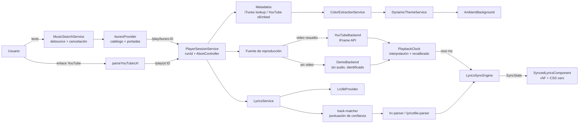

# Liriks — Arquitectura

Documento de arquitectura de la **Fase 1 (MVP)** la **Fase 2 (experiencia visual)** y la **Fase 3 (IA, parcial)**. Describe qué se construyó, por qué, y qué queda explícitamente fuera.

## 1. Decisiones principales

| Decisión | Elección | Motivo |
|---|---|---|
| Frontend | Angular 22 (standalone, signals, zoneless-friendly), TypeScript estricto, SCSS | Pedido por la especificación; signals dan actualizaciones puntuales sin reconstruir la UI. |
| Backend en Fase 1 | **Ninguno** | Todos los proveedores usados permiten CORS (verificado, ver §3) y no hay secretos que proteger. Añadir Spring Boot ahora sería código sin función. |
| Base de datos | Ninguna (`localStorage`) | Favoritos/historial/ajustes locales bastan. PostgreSQL entra en la Fase 4. |
| Reproducción | YouTube IFrame Player API, **visible** | Es el único proveedor de reproducción completa sin cuenta. Sin extraer audio, sin ocultar el reproductor. |
| Reloj de verdad | El tiempo del reproductor | El motor de letras nunca tiene un temporizador propio que corra con el reproductor en pausa. |
| Dependencias de runtime | `yaml` (único añadido) | El formato por palabra de LRCLIB es YAML. Color, animación, búsqueda y UI son código propio; no se usaron GSAP, Color Thief ni librerías de UI. |
| Tipografía | Plus Jakarta Sans | Geométrica, cálida y muy legible en peso 600 a tamaños grandes. |

## 2. Flujo de datos



### Resolución de una canción (`PlayerSessionService.open`)

1. **Metadatos** — `itunes:<id>` → iTunes lookup. `yt:<id>` → YouTube oEmbed (título/canal) y, con ese título, se busca la canción en el catálogo para obtener portada oficial y duración; si no hay coincidencia exacta se usa lo que dio YouTube.
2. **En paralelo**: fuente de reproducción y letras (ninguna espera a la otra).
3. **Fuente**: video indicado (`?v=`) → video del enlace → búsqueda con YouTube Data API **si el usuario puso su clave** → modo demostración.
4. **Letras**: candidatos de todos los proveedores → puntuación → estado. Cuando el reproductor revela la **duración real** del video, se reevalúa (un MV con intro puede pedir otra versión de letra).
5. Cada `open()` invalida al anterior (`runId` + `AbortController`): una respuesta tardía de la canción previa se descarta. Hay una prueba que falla si esa guarda se elimina.

## 3. Verificación de APIs

Verificado con peticiones reales durante el desarrollo (no de memoria):

| API | Resultado |
|---|---|
| LRCLIB `/api/search`, `/api/get` | Responden con `access-control-allow-origin: *`. Devuelven `syncedLyrics` (LRC), `plainLyrics`, `instrumental` y — dato que no estaba en la especificación — `hasWordSync` + `lyricsfile` (YAML con `start_ms` **por palabra**). El motor usa esos tiempos reales. `/api/get` sin coincidencia devuelve 404 `TrackNotFound`. |
| iTunes Search / Lookup | CORS abierto. Portadas en `…/{N}x{N}bb.jpg` (200/600/1000 verificados), CORS abierto → permite leer píxeles en Canvas. Devuelve menos filas que `limit` por duplicados (se colapsan). |
| YouTube oEmbed | Devuelve título, canal y miniatura con CORS; 401/404 para videos no insertables/inexistentes (mapeado a mensaje claro). |
| YouTube IFrame API | Probada en navegador: carga, reproduce, `getCurrentTime`/`getDuration`, `seekTo`, eventos de estado y errores. |

**No verificado / pendiente de revisión manual** (no afirmar lo contrario):

- **Términos de uso de LRCLIB**: su sitio se renderiza con JavaScript y no pude leerlos programáticamente. Su contenido es colaborativo; **no asumir licencia comercial**. No hay límites de uso confirmados; la app cachea 30 min por consulta.
- **YouTube Data API v3** (costo de cuota de `search.list`, cuota diaria por defecto): escrito según la documentación al momento de implementar; **confirma en tu Google Cloud Console** antes de depender de ello.
- **Musixmatch** y **Apple MusicKit**: **no implementados** ni evaluados contra su documentación. Ver §9.

## 4. Capas y módulos

```
src/app/
├── core/
│   ├── models/        Track, SyncedLyrics, estados, AppError
│   ├── lyrics/        PURO (sin Angular): parsers, motor, matching, normalización
│   ├── providers/     LRCLIB, iTunes, YouTube (+ http.ts: fetch con timeout/cancelación)
│   └── services/      Reloj, backends de reproducción, sesión, tema, ajustes, historial
├── features/
│   ├── home/  search/  player/  lyrics/  visualizer/  settings/
└── shared/            icon.component, format
```

Regla: `core/lyrics` no importa Angular. Es el activo más importante del producto y se prueba sin TestBed.

Servicios del plan original → equivalentes: `MusicSearchService`✔, `LyricsParserService`→`lrc-parser`/`lyricsfile-parser` (funciones puras), `LyricsMatchingService`→`track-matcher`, `LyricsSyncEngine`✔, `PlaybackService`✔ (+ `PlaybackBackend` como `MusicProviderService`), `ColorExtractionService`✔, `DynamicThemeService`✔, `SettingsService`✔, `PlayerStateService`→`PlayerSessionService`. `LyricLine/WordComponent` **no** son componentes: una línea por componente costaría rendimiento sin beneficio; el progreso por palabra se escribe como variable CSS.

## 5. Motor de sincronización

- **Unidad**: milisegundos en todo el sistema.
- **Convención de offset** (única): `offset > 0` = las letras aparecen **más tarde**; `< 0` = **antes**. El motor consulta `tiempoReproductor − offset`. Se guarda por canción **y versión** (`track.id|videoId`), clamp ±30 s.
- **`LyricsSyncEngine.resolve(t, offset)`** → línea activa, progreso de línea, palabra activa y su progreso, `isBreak`, progreso de pausa, fase. Búsqueda binaria + atajo O(1) para reproducción continua; seeks hacia atrás/adelante recalculan sin estado acumulado (probado con 2 000 tiempos aleatorios contra búsqueda lineal).
- **Pausas instrumentales** reales: marcas vacías del LRC (≥ 3,5 s), huecos implícitos (≥ 7 s) o intro (≥ 4 s) se convierten en líneas `isBreak`. Los tres puntos se encienden según el progreso **real** del hueco.
- **Fin de línea**: viene del formato (`end_ms`), de una marca vacía posterior, o se estima (1,2 s + 80 ms/carácter, acotado). Solo afecta a la animación, no a cuál línea está activa.
- **Niveles**: 1 líneas ✔ · 2 palabras ✔ (real, cuando LRCLIB trae `lyricsfile`) · 3 sílabas ✘ · 4 aproximado ✔ (opcional, **rotulado** "aproximado") · 5 sin sincronía ✔ (texto plano con aviso).
- **`PlaybackClock`**: interpola entre lecturas (cada 250 ms) para 60 FPS visuales. Solo corre en `PLAYING`; error > 350 ms → salto (seek), si no, corrección gradual (sin retrocesos visibles). Probado: sin deriva tras 10 min con ruido ±40 ms.

## 6. Identificación y confianza

`scoreLyricsCandidate` combina título (40 %), artista (30 %), duración (20 %), álbum (5 %) + bono de sincronía, con **topes**: otro artista ≤ 0,4; título distinto ≤ 0,35; duración > 15 s ≤ 0,5; **sin duración de referencia ≤ 0,79**. Nivel `high` exige duración comprobada (±6 s).

| Estado | Cuándo | Qué ve el usuario |
|---|---|---|
| `FOUND_SYNCED` | `high` o elección manual | Letras sin avisos |
| `MATCH_UNCERTAIN` | `medium` | Letras + aviso + "Elegir otra versión" |
| `NOT_FOUND` | `low` o sin datos | Mensaje + alternativas |
| `FOUND_PLAIN` | solo texto plano | Texto estático + aviso |
| `INSTRUMENTAL` / `ERROR` | — | Mensaje específico |

Se normalizan Official Video/HD/4K/Visualizer, pero se **conservan** live/acoustic/remix/feat. para distinguir versiones (penalización −0,25 si difieren).

## 7. Sistema visual

- **Colores**: `extractPalette` cuantiza en matiz/saturación/luminosidad ponderando por saturación (los grises "dicen" menos de una portada), elige dominante/secundario/acento, y **garantiza contraste ≥ 4,5:1** con texto blanco oscureciendo hasta cumplirlo. Si la portada no se puede leer, paleta de respaldo **determinista por título/artista** y marcada `fromArtwork: false`.
- **Fondo**: tres gradientes radiales (dominante/secundario/acento) + viñeta + textura sutil; solo `transform`/`opacity`; en pausa si la pestaña no es visible. Las variables CSS están registradas con `@property`, así el color **se anima** entre canciones.
- **Tipografía fluida** con `clamp()`: letra 30–70 px (≈64 px a 1920), título 24–36, artista 16–22, meta 12–16.
- **Letras**: línea activa escala 1, el resto 0,9 con opacidad por distancia y desenfoque opcional; scroll nativo (el usuario puede explorar; aparece "Volver a la letra actual").
- **Movimiento**: `prefers-reduced-motion` o ajuste propio → transiciones ≈ 0, sin fondo animado.
- **Modos (Fase 2)**: `viewMode` en `SettingsService` se refleja en `data-mode` del escenario y `data-view` de `:root`. *Cinematográfico* y *karaoke* reutilizan el diseño compacto (mixin SCSS `compact`, compartido con móvil) con el video de YouTube junto a los controles; *minimalista* quita desenfoque, textura, sombras y movimiento de fondo; *portada* agranda la carátula y reduce la letra (`--mode-scale`). Tipografía bajo demanda (solo se descarga la familia elegida) vía `--font-sans`.
- **Transiciones entre canciones**: bloques con clave (`@for` sobre un array de un elemento) recrean el DOM de título/letras al cambiar de pista y re-lanzan una animación de entrada escalonada; el color ya se animaba con `@property`. No hay animación de *salida*.
- **Partículas en pausas**: aparecen solo cuando la línea activa es una pausa instrumental **real** (`breakActive`) y la música suena. No se simula análisis de audio: el fondo no reacciona al ritmo porque no hay señal de audio autorizada.
- **Karaoke**: la palabra actual recibe una clase `now` (elevación + brillo con el acento) que se alterna solo cuando cambia de palabra.
- **Rendimiento de letras**: el bucle omite el cuadro si no cambió (tiempo, motor, ajuste), `contain: layout style` por línea, escrituras de `--p` en pasos del 2 %.
- **Deliberadamente ausente**: tarjetas, neones, glassmorphism excesivo (solo en paneles flotantes), botones decorativos. No hay "anterior/siguiente" porque no existe cola.

## 8. Seguridad y privacidad

- Sin backend ni secretos. La clave de YouTube es **opcional**, la pone el usuario, se guarda **solo en su navegador** y se recomienda restringirla por referente HTTP. No hay claves en el repositorio.
- Todo texto externo (letras, títulos) se pinta con interpolación de Angular (escapado); no hay `innerHTML`.
- Entradas validadas: enlaces (`parseYouTubeUrl` con lista de hosts e id de 11 caracteres), ids de ruta (regex), ids de iTunes (dígitos), valores de `localStorage` (`sanitize`).
- Las peticiones solo envían lo necesario (texto de búsqueda). Nada de datos del usuario en URLs más allá de la consulta.
- Pendiente para producción: CSP, y backend con límites de solicitudes si se añaden proveedores con claves secretas.

## 9. Cumplimiento y licencias

- **No** se descarga ni extrae audio, no se bloquean anuncios, no se oculta el reproductor (la IFrame se muestra ≥ 200 px de alto).
- **Modo demostración** (sin audio) existe **solo** cuando no hay video vinculado, está rotulado en pantalla y no se presenta como reproducción real.
- Letras (LRCLIB) y portadas (Apple) se usan **de forma experimental**: sin licencia comercial asumida. Para distribución comercial: contratar proveedor licenciado de letras (p. ej. Musixmatch) tras un backend, y revisar condiciones de uso de portadas. La interfaz `LyricsProvider` / `PlaybackBackend` permite sustituirlos sin tocar el resto.
- No se almacenan letras completas (solo caché en memoria de 30 min por sesión).

## 10. Estado de la especificación

**Implementado (Fase 1)**: búsqueda con autocompletado/historial/teclado/cancelación; enlaces de YouTube; IFrame API; LRCLIB (+ palabra); parser LRC y lyricsfile; sincronización por línea y palabra; portada oficial; fondo dinámico desde la portada; scroll automático y exploración manual; controles básicos; ajuste de sincronía por versión; elección de otra versión de letras; responsive; manejo de errores; accesibilidad base; pantalla completa; Media Session.

**Fase 2 implementado**: 5 modos de visualización, familia tipográfica, tamaño de portada, transiciones de entrada entre canciones, partículas en pausas instrumentales reales, énfasis de palabra (karaoke), selector de modo con aviso accesible y atajo `V`.

**No implementado** (fases posteriores): animación de *salida* entre canciones; fondo reactivo al audio (requiere audio autorizado + Web Audio); cola y anterior/siguiente; sincronía por sílaba; módulo de IA (Whisper/WhisperX/Demucs); cuentas, favoritos, PostgreSQL, backend Spring Boot; Musixmatch; Apple MusicKit; MusicBrainz/Cover Art Archive; despliegue y monitoreo; pruebas E2E automatizadas y de rendimiento (las comprobaciones de navegador de esta fase fueron manuales).

## 11. Pruebas

`npm test` — 147 pruebas (Vitest): parser LRC (marcas múltiples, offsets, duplicados, orden, silencios), motor (seek, offset, pausas, palabras, aproximado), reloj (pausa, seek, deriva), matching y selección de video, paleta (contraste), proveedores con `fetch` simulado, búsqueda (debounce, carrera, cancelación), sesión (cambio rápido, errores, offset persistente). Datos ficticios; no usan canciones reales.

## 11b. Fase 3 — Servicio de IA y Estudio

### Arquitectura

```mermaid
flowchart LR
  subgraph Browser[Liriks (Angular)]
    ST[Estudio /studio] --> LA[LocalAudioBackend<br/>audio del usuario]
    ST --> ED[lyrics-editor.ts<br/>edición pura + tap-sync]
    ED --> EXP[LRC / JSON]
    ED --> PV[SyncedLyricsComponent<br/>misma vista previa]
    LA --> CLK[PlaybackClock] --> PV
    ST -->|multipart + derechos| CL[AiServiceClient]
  end
  CL -->|HTTP 127.0.0.1:8765| API
  subgraph AI[ai-service (Python, opcional)]
    API[FastAPI<br/>validación · CORS · límites] --> JM[JobManager<br/>1 trabajador]
    JM --> PL[pipeline] --> BK{Backend}
    BK --> WX[WhisperX + Demucs]
    BK --> FK[Demo sin IA]
    PL --> PP[postprocess<br/>confianza · silencios] --> EX[exporters]
  end
```

### Decisiones

- **Servicio aparte y opcional** (Python 3.12, FastAPI): el módulo de IA no puede impedir que funcione el resto. Si está apagado, el Estudio sigue con sincronización manual.
- **Backends intercambiables** (`Backend`: separar, transcribir, alinear letra). El pipeline, la API y el postproceso no conocen modelos concretos; hay un backend de demostración determinista para desarrollo y pruebas, siempre rotulado `demo`.
- **Prioridad a la alineación de una letra aportada** frente a transcribir (más fiable); plan B automático por emparejado de texto si falta memoria.
- **Lógica de valor = código puro y probado**: interpolación de tiempos, agrupación en líneas, confianza, pausas, exportadores y editor no dependen de modelos ni de GPU.
- **Audio autorizado**: `rights_confirmed` obligatorio; sin parámetros de URL; el audio no se conserva; el nombre del cliente no toca el disco; el servicio escucha en local.
- **Reproducción de audio propio** (`LocalAudioBackend`) = el "modo de reproducción independiente" de la especificación: sin restricciones de proveedor porque el audio es del usuario.
- **Formato común**: el JSON exportado (`liriks-synced-lyrics` v1) tiene la forma de `SyncedLyrics` + metadatos y se puede reimportar. La compatibilidad Python↔TypeScript se comprueba con fixtures generados por el servicio.

### Estado (honesto)

| | |
|---|---|
| Probado automáticamente | pipeline, interpolación, agrupación, confianza, silencios (audio sintético real vía ffmpeg), exportadores, API completa y seguridad (77 pruebas Python); editor, importación/exportación, interoperabilidad, cliente (TS) |
| Probado manualmente en navegador | Audio local → trabajo en el servicio (demo) → editor → marcar, tap-sync, deshacer → vista previa → exportación |
| **No ejecutado** | **Rutas de IA reales** (WhisperX transcripción/alineación, Demucs): escritas contra las firmas de whisperx 3.8.6 / demucs 4.1.0 leídas de sus ruedas, pero sin instalar torch/CUDA ni descargar modelos. Hay que validarlas con audio real y revisar rendimiento en la GPU (6 GB) |
| No hecho | Sincronía por sílaba; diarización (hay `pyannote` como dependencia de whisperx pero no se usa); detección propia de voces superpuestas/coros/auto-tune; EDL de múltiples idiomas en una canción |

### Dificultades de audio y qué se hace

Voces superpuestas, coros, rap rápido, cambios de idioma, auto-tune, reverberación, gritos e intros instrumentales: solo hay indicadores indirectos (baja confianza, tiempos interpolados, `fast_speech`, `in_silence`, `repetition`, pausas medidas). No hay detectores dedicados; Whisper/VAD están diseñados para habla y pueden omitir tramos cantados. **La revisión manual en el Estudio es parte del diseño.**

## 12. Hoja de ruta

1. **Fase 2** ✔ (pendiente: animación de salida y medición de FPS en un navegador en primer plano).
2. **Fase 3** ✔ estructura, servicio, Estudio, edición y exportación (pendiente: **validar la IA real** con audio autorizado y medir rendimiento en GPU).
3. **Fase 4**: backend Spring Boot + PostgreSQL (cuentas, favoritos, historial, ajustes por usuario), Musixmatch tras el backend, cola de reproducción, MusicKit.
4. **Fase 5**: E2E (Playwright), rendimiento, CSP, monitoreo, revisión legal de licencias, gestión de cuotas.
